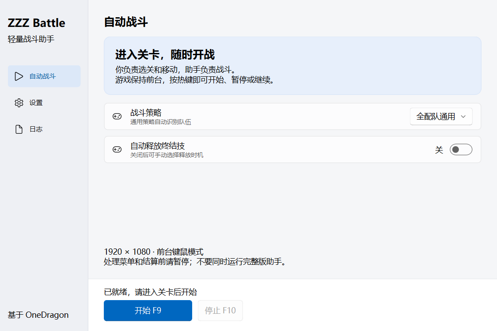

# ZZZ Battle · 绝区零轻量战斗助手

**手动进入关卡，一键开始战斗。** 基于 [绝区零一条龙](https://github.com/OneDragon-Anything/ZenlessZoneZero-OneDragon) 的个人 fork，提供一个专门用于自动战斗的独立窗口。

界面参考 [BetterGI](https://github.com/babalae/better-genshin-impact) 的 Fluent 风格，只保留「自动战斗」「设置」「日志」三个页面。使用原项目的战斗策略与识别能力，不需要从完整版一条龙菜单进入。



## 使用

1. 下载本 fork 的 **`codex/battle-assistant` 分支**源码，解压到固定目录；也可以克隆本分支。
2. 首次双击根目录 **`安装战斗助手.cmd`**，联网准备本地运行环境，无需预装 Python。
3. 日常双击 **`启动战斗助手.cmd`**。打开游戏，设为 1920×1080，手动进入关卡。
4. 选择战斗策略，按 **F9** 开始 / 暂停 / 继续，**F10** 停止。热键以窗口实际显示为准。

```powershell
git clone --branch codex/battle-assistant https://github.com/sagirimo/ZenlessZoneZero-OneDragon.git
```

Windows x64。游戏保持前台，游戏键位与设置页一致；切换窗口、操作菜单和处理结算前请暂停。若游戏以管理员身份运行，助手也需使用相同权限。启动文件依赖整个项目目录，不能单独移走。

## 这个版本改了什么

- **独立启动**：只初始化战斗所需服务，绕过完整启动器、OCR 初始化与非战斗应用。
- **更少界面工作**：运行状态变化时才刷新；日志最多保留 200 条，隐藏日志页时停止刷新。
- **明确的启停和错误提示**：后台准备资源，重复开始不创建第二个任务；停止与关闭等待任务结束并释放按键。
- **独立配置**：继承已有策略和键位，后续改动保存在专用 YAML 文件中。

依赖安装仍沿用上游锁文件，首次安装需要网络。战斗模型沿用原项目，缺失时需要联网获取。本版本没有重写角色策略，也没有改动闪避与连携判定；目前尚未完成真实游戏中的帧率、闪避率和连携时序验证。

## 验证与源码

21 项针对性测试通过，覆盖配置隔离、初始化失败、取消与关闭、状态更新、日志缓存等；本机原生 Qt 窗口初始化和关闭检查通过。源码与测试分别保存在主仓及 [配套测试 fork](https://github.com/sagirimo/zzz-od-test/tree/codex/battle-assistant)。

[设计、配置与测试说明](../docs/develop/zzz/battle_standalone.md) · [GPL-3.0 许可证](../LICENSE)

## 致谢

战斗引擎、策略、资源与基础框架来自 OneDragon-Anything 及原项目贡献者，本 fork 保留原版权与 GPL-3.0 许可证。BetterGI 仅作为界面布局参考，没有使用其标志、插画或代码。此分支为个人定制版。

<details>
<summary>查看原版一条龙项目介绍</summary>

<!-- markdownlint-restore -->
<div align="center">


<div>

---

</div>

__ZenlessZoneZero-OneDragon__


<div>
    
    
</div>
<div>
    
    
</div>

[](https://deepwiki.com/OneDragon-Anything/ZenlessZoneZero-OneDragon)

学习实践 __图像识别 & 自动化__ 的智能解决方案

✨ 如果喜欢本项目，欢迎右上角点亮`Star`支持 ✨

</div>

## 🚀 功能介绍

<div align="left">

🤖 __自动战斗__：支持自定义逻辑、技能标记、条件、变量等进阶用法

🛡️ __闪避助手__：基于声音、图像一体化模型识别，轻占用，高准确

🧹 __日常清理__：影像店、刮刮乐、咖啡店、材料、奖励等全日常清理

☕ __空洞作战__：基于大模型训练的识别、事件、寻路的功能模块

⏲️ __更多功能__： 定时启动、多账号切换、定时任务、自动对话……

</div>

## 📸 页面预览

<div align="center">


*✨ 简洁直观的操作界面 ✨*

</div>

## ⚠️ 免责声明

📌 本项目仅供学习交流，开发者团队保留最终解释权

🎨 项目LOGO版权归[巡夜子](https://github.com/yokuminto)及全体开发者所有

⚖️ 使用本工具产生的一切风险需自行承担

🚫 本项目未授权任何个人、商家、自媒体账号等进行售卖

🚫 若您遇到商家使用本软件进行代练并收费，产生的任何问题及后果与本软件无关

🚫 开发者团队不会为您提供任何"售后"服务

## 🌟 贡献者们

<div>

感谢参与项目的所有贡献者 ([完整名单](https://github.com/DoctorReid/ZenlessZoneZero-OneDragon/graphs/contributors))：


是你们的参与共同构建了这个项目，让这个项目越来越好♡
如果想要参与开发，欢迎查看 [贡献者招募](../docs/develop/RECRUITING.md)（技术栈 / 参与方式 / 成长故事），并按 [快速开始](../docs/develop/setup/quickstart.md) 把项目跑起来，期待你的加入 ✨

</div>

## 📢 官方渠道

<div>

🔗 [官方网站](https://one-dragon.com/)
> 项目简介 | 新手入门 | 功能说明 | 配置说明

💬 [官方频道](https://pd.qq.com/g/onedrag00n)
> 公告要闻 | 软件科研 | 游戏攻略 | 趣闻分享

❓ [官方文档](https://docs.qq.com/doc/p/7add96a4600d363b75d2df83bb2635a7c6a969b5)
> 常见问题 | 故障速查 | 疑难诊断 | 更新指南

👉 [官方议题](https://github.com/OneDragon-Anything/ZenlessZoneZero-OneDragon/issues)
> 故障反馈 | 问题讨论 | 优化建议 | 建言收集

👨‍👨‍👦‍👦 玩家社群
> 闲聊吹水 | 趣闻互动 | 交流同好 | 晒卡吸欧
>
> 见频道关联群聊，入群前先对该项目点个 ⭐star，入群问题的项目仓库的答案为ZenlessZoneZero-OneDragon，入群后需校验你的 Github 账号的 username
>
> 提示：推荐 GitHub 用户加入，并注意 username 和 Name 的区别，请遵守群规，友善交流

</div>

## 📝 签名策略 (Code Signing Policy)

免费代码签名由 [SignPath.io](https://signpath.io/) 提供，证书由 [SignPath Foundation](https://signpath.org/) 颁发

审批人：[DoctorReid](https://github.com/DoctorReid) [ShadowLemoon](https://github.com/ShadowLemoon)

Free code signing provided by [SignPath.io](https://signpath.io/), certificate by [SignPath Foundation](https://signpath.org/)

Approvers: [DoctorReid](https://github.com/DoctorReid) [ShadowLemoon](https://github.com/ShadowLemoon)

## 🔒 隐私政策 (Privacy Policy)

本程序的隐私政策详见：[隐私政策](PRIVACY.md)。

See the [Privacy Policy](PRIVACY.md).

## ☕ 支持我们

<div align="center">

如果本项目为您带来便利，欢迎支持服务器维护：


💖 查看[致谢名单](https://onedragon-anything.github.io/other/zh/like/thanks_2024.html)

</div>

</details>
